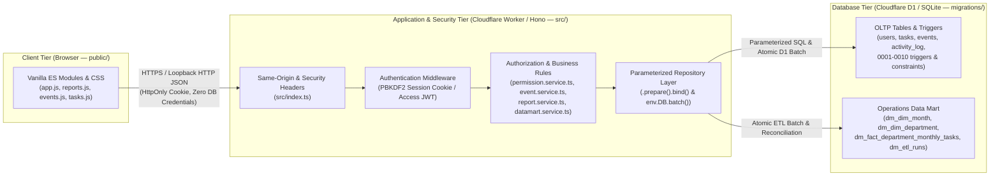

# CS 213 – Database Management System (SA 3)
# DSC Operations Management System (DSC OMS) — Project Documentation

**Course:** CS 213 – Database Management System  
**Assessment:** SA 3 – Database Application Project  
**Prepared for:** Prof. Ivy Kim D. Machica  
**Application Root:** `dsc-oms-cs213/`  
**Date:** November 26, 2026 (PHT)

---

## 1. Problem Definition & Scope

### 1.1 Problem Statement
- **Intended Users:** Student organization leaders (**Lead**, **Co-Lead**), department heads (**Executive**), general members (**Member**), and temporary event officers (**Event Director**, **Team Head**) within the Developer Student Community (DSC).
- **Current Process:** Operations are fragmented across manual Google Sheets trackers (separate tabs for tasks, project rosters, event staffing, and announcements) without row-level atomicity, role-based access enforcement, or consistent audit trails.
- **Problems Addressed:**
  1. **Privilege Drift & Uncontrolled Edits:** Shared spreadsheets expose all columns to editors, risking unauthorized assignments, status overwrites, or deletion of historical records.
  2. **Orphaned & Partial Updates:** Multi-step operations (e.g., creating an Event task with its link and audit log, or closing an Event and ending temporary appointments) can fail halfway in manual workflows.
  3. **Lack of Auditable Reporting & Analytics:** Leaders cannot reliably filter active records, exclude draft/archived entries from grouped summaries, detect overdue exceptions automatically, or reconcile operational totals against a monthly reporting mart.

### 1.2 System Scope
- **What the System WILL Do:**
  - Authenticate users locally with **PBKDF2-SHA256** (`100,000` iterations) password hashing and `HttpOnly`, `SameSite=Strict` session cookies (while retaining Cloudflare Access JWT compatibility).
  - Manage permanent organization directory records (**Departments**, **Users**, **Projects**, **Tasks**, **Requests**, **Announcements**, **Notifications**) and governance-aware **Events** (11-stage lifecycle, Teams, consent-based temporary appointments, Readiness/Closure verification, Operational Issues, Schedules, Notes, Debriefs).
  - Execute complete end-to-end workflows (e.g., **Event Proposal → Lead Approval → Team Formation → Delegated Event Task Creation → Task Assignment & Review → Reporting & Data Mart ETL**).
  - Enforce server-side **Role–Permission Matrix** checks and database-level **SQLite triggers / constraints**.
  - Generate **Detailed**, **Grouped Summary (excluding Draft/Archived)**, and **Exception** reports, plus an **Operations Analytics Data Mart** (`dm_dim_month`, `dm_dim_department`, `dm_fact_department_monthly_tasks`, `dm_etl_runs`) with OLTP reconciliation.
- **What the System WILL NOT Do:**
  - It does **not** connect directly from browser JavaScript to SQLite/D1 or expose database credentials to the client.
  - It does **not** implement live Google Sheets API synchronization, payment processing, or asset inventory ledgers (CSV export and controlled independent-task CSV import handle structured task exchange).
  - Temporary Event roles (**Event Director**, **Team Head**) do **not** grant permanent edit, assignment, review, or user-management authority.

---

## 2. Testable Functional & Non-Functional Requirements

Requirements are tagged as **Core** (operational directory, workflows, RBAC, and DB integrity) or **Enhancement** (local session security, analytics reporting, Data Mart, CSV import, and delegated Event task creation).

| ID | Category | Classification | Requirement Statement |
| --- | --- | --- | --- |
| `FR-01` | Core | **Core** | The system shall allow authorized permanent roles (`Lead`, `Co-Lead`, `Executive`) to create, view, search, filter, update, and archive/deactivate tasks, projects, and department records. |
| `FR-02` | Core | **Core** | The system shall prevent duplicate unique identifiers (`departments.name`, `users.email`, `event_teams(event_id, name)`, `tasks.source_request_id`) using database `UNIQUE` constraints. |
| `FR-03` | Core | **Core** | The system shall enforce the 11-stage Event lifecycle (`Draft` → `Completed`/`Cancelled`) and consent-based temporary appointments (`Proposed` → `Accepted`/`Declined`/`Ended`). |
| `FR-04` | Core | **Enhancement** | The system shall allow an accepted **Event Director** (Event or activated team) or accepted **Team Head** (exact appointed team only) to create unassigned Event tasks during `Team Formation` through `Post-Event`. |
| `FR-05` | Core | **Enhancement** | The system shall support controlled CSV import of up to 100 unassigned independent tasks with preflight validation, duplicate detection, and per-row retry receipts (`task_import_receipts`). |
| `SEC-01` | Security | **Enhancement** | The system shall authenticate users via email and password hashed with PBKDF2-SHA256 (`100,000` iterations, 16-byte random salt) and issue `HttpOnly`, `SameSite=Strict` session tokens stored as SHA-256 hashes in `auth_sessions`, revoking them upon logout. |
| `SEC-02` | Security | **Core** | The system shall enforce a server-side Role–Permission Matrix on every API route (`requireAuth`, `requirePermission`), rejecting unauthorized direct API requests with `403 FORBIDDEN` even if UI navigation is hidden. |
| `SEC-03` | Security | **Core** | The system shall execute all SQL queries using parameterized `.prepare(...).bind(...)` bindings and block cross-origin mutating requests (`403 CROSS_ORIGIN_FORBIDDEN`). |
| `SEC-04` | Security | **Core** | The system shall log sensitive mutations and security events (`AUTH_LOGIN_SUCCESS`, `AUTH_LOGIN_FAILED`, `AUTH_LOGOUT`, `USER_CREATED`, `EVENT_TASK_CREATED`, `DATAMART_ETL_LOADED`) in `activity_log` with actor ID, name, role, timestamp, and reference ID. |
| `SEC-05` | Security | **Enhancement** | Delegated Event task creation shall reject privilege-bearing fields (`assigneeUserId`, `projectId`, `departmentId`, `status`, `progress`) with `400 VALIDATION_ERROR`. |
| `TRX-01` | Transaction | **Enhancement** | `POST /api/events/:id/tasks/create` shall insert the task, `TASK_CREATED` audit, `event_task_creation_requests` receipt, `event_task_links` link, and `EVENT_TASK_CREATED` audit in a single atomic D1 batch; any constraint or trigger failure rolls back all writes. |
| `TRX-02` | Transaction | **Core** | Concurrent conflicting writes (e.g., two sessions proposing an `Event Director` on the same Event, or mutating a record after stage/status changed) shall allow at most one commit and reject the stale/conflicting request with `409` (`EVENT_CONFLICT` / `STATE_CONFLICT`). |
| `TRX-03` | Transaction | **Enhancement** | Retrying `POST /api/events/:id/tasks/create` with an identical `requestId` and payload shall return `200` with the existing task (`replayed: true`), while reusing `requestId` with changed fields shall return `409`. |
| `RPT-01` | Reporting | **Enhancement** | The system shall generate a **Detailed Task Records Report** filterable by creation date range (`startDate`, `endDate`), department, and status, excluding `Archived` tasks by default. |
| `RPT-02` | Reporting | **Enhancement** | The system shall generate a **Grouped Summary Report** by department that excludes `Archived` tasks and `Draft` projects/events and reports exact exclusion counts alongside totals. |
| `RPT-03` | Reporting | **Enhancement** | The system shall generate an **Exception Report** for a given `asOfDate` flagging overdue incomplete tasks (`deadline <= asOfDate`), unassigned `High`/`Critical` tasks, and unresolved `High`/`Urgent` event issues. |
| `ADV-01` | Data Mart | **Enhancement** | The system shall extract non-archived operational tasks into a star schema (`dm_dim_month`, `dm_dim_department`, `dm_fact_department_monthly_tasks`, `dm_etl_runs`) in a single atomic ETL batch and log `DATAMART_ETL_LOADED`. |
| `ADV-02` | Data Mart | **Enhancement** | The system shall reconcile monthly and total Data Mart task counts against OLTP non-archived source counts and report `reconciled: true` only when every month and the grand total match exactly. |

---

## 3. Business Rules

1. **Authentication & Account Rules:** Only `Active` registered users with matching PBKDF2-SHA256 credentials (or valid Cloudflare Access JWT in cloud mode) may obtain a session. Revoked or expired session tokens fail closed (`401 UNAUTHENTICATED`).
2. **Task Ownership & Lifecycle Rules:** Every task belongs to one `Active` permanent department. Valid status transitions are enforced by `oms_task_state_guard` (`Created` → `Assigned` → `Ongoing` → `For Review` → `Completed` ↔ `Archived`). Deadlines cannot precede `start_date`.
3. **Delegated Event Task Creation Rules:** Allowed **only** in stages `Team Formation`, `Planning`, `Preparation`, `Ready for Event`, `Ongoing`, and `Post-Event`. Created tasks always start `Unassigned`, `project_id = NULL`, `status = 'Created'`, owned by the creator's permanent department. `Event Co-Director`, `Team Co-Head`, and `Team Member` receive no delegated creation grant.
4. **Transaction-Blocking Conditions:**
   - Demoting or deactivating the last active `Lead` (`oms_last_lead_guard`).
   - Creating an Event task after the actor becomes `Inactive`, their appointment ends, or the Event leaves the eligible stages (`oms_event_task_creation_guard`).
   - Proposing a second open `Event Director` (`ux_event_one_open_director`) or `Team Head` (`ux_event_one_open_team_head`).
   - Advancing an Event to `Ready for Event` while `High`/`Urgent` issues remain unresolved (`m3_blocking_issues`) or Readiness checklist items remain unverified (`m3_ready_requirements`).

---

## 4. Role–Permission Matrix & Application

### 4.1 Role–Permission Matrix

| Function / Endpoint Group | Lead | Co-Lead | Executive | Member | Accepted Event Director *(Event-scoped)* | Accepted Team Head *(Team-scoped)* |
| --- | :---: | :---: | :---: | :---: | :---: | :---: |
| Sign In / Sign Out (`POST /api/auth/login`, `/logout`) | Allowed | Allowed | Allowed | Allowed | Allowed | Allowed |
| View Directory, Departments, Tasks, Events | Allowed | Allowed | Allowed | Allowed | Allowed | Allowed |
| Create/Update General Tasks (`POST /api/tasks`) | Allowed | Allowed | Own Dept | Denied | Denied *(unless Exec+)* | Denied *(unless Exec+)* |
| Create Unassigned Event Task (`POST /api/events/:id/tasks/create`) | Allowed | Allowed | Denied *(unless appointed)* | Denied *(unless appointed)* | Exact Event & Activated Teams | Exact Appointed Team Only |
| Import CSV Independent Tasks (`POST /api/tasks/import/apply`) | Allowed | Allowed | Own Dept | Denied | Denied | Denied |
| Approve / Reject / Close Events | Allowed | Allowed | Denied | Denied | Denied | Denied |
| Create / Edit User Accounts (`POST /api/users`) | Allowed | Allowed | Denied | Denied | Denied | Denied |
| Change User Role / Deactivate User (`PATCH /api/users/:id/role`) | Allowed | Denied | Denied | Denied | Denied | Denied |
| Manage Departments (`Create / Rename / Activate-Deactivate`, `/api/departments`) | Allowed | Denied | Denied | Denied | Denied | Denied |
| View Reports & Run Data Mart ETL (`/api/reports/*`) | Allowed | Allowed | Denied | Denied | Denied | Denied |
| View Audit Log (`GET /api/reports/activity`) | Allowed | Allowed | Denied | Denied | Denied | Denied |

### 4.2 How the Matrix Is Applied
1. Each user holds one permanent system role (`Lead`, `Co-Lead`, `Executive`, or `Member`) in `users.role`, plus optional temporary event appointments in `event_appointments`.
2. After login (`POST /api/auth/login`), the browser hides restricted navigation links (`Reports`, `Audit Log`, `Add Member`) based on `/api/auth/me`.
3. **Server enforcement is authoritative:** Every API route executes `requireAuth` followed by `requirePermission(...)` (in `src/middleware/authorization.ts`) or service-level capability queries (`eventTaskCapabilities` in `src/services/event.service.ts`) **and** database triggers before any write commits. Hiding a menu alone never protects an endpoint.

### 4.3 Sample Security Test Case (`TC-SEC-01`)

| Field | Details |
| --- | --- |
| **Test ID** | `TC-SEC-01` (Requirement: `SEC-02`, `SEC-04`) |
| **Objective** | Verify that only an authorized `Lead`/`Co-Lead` can create a user account and access restricted reports, even when a `Member` sends direct HTTP API requests. |
| **Precondition** | Active `Lead` (`demo.lead@example.test`) and `Member` (`demo.member@example.test`) accounts exist with seeded PBKDF2 credentials. Account `test_clerk@example.test` does not exist. |
| **Steps** | 1. Sign in as `Member` via `POST /api/auth/login`. 2. Attempt `POST /api/users` with `{ name: "Test Clerk", email: "test_clerk@example.test", departmentId: "demo_dept_eng", role: "Member" }` and `GET /api/reports/overview`. 3. Verify `users` count for `test_clerk@example.test` is `0`. 4. Sign in as `Lead` and submit the same `POST /api/users` request. |
| **Expected Result** | `Member` receives HTTP `403 FORBIDDEN` on both `POST /api/users` and `GET /api/reports/overview`; `test_clerk@example.test` does not exist. `Lead` receives HTTP `201 Created`, and `test_clerk@example.test` appears exactly once in `users` and `activity_log` (`USER_CREATED`). |
| **Actual Result & Status** | Executed in `test/node/cs213-sa3.test.mjs` and `test/cs213_browser_e2e.py`: `Member` received `403` on both calls (`0` rows inserted); `Lead` received `201` (`1` row inserted, `USER_CREATED` logged). **Status: PASS**. |

---

## 5. Client–Server Architecture & Request Walkthrough

### 5.1 Three-Tier Architecture Diagram

### 5.2 Request-to-Result Walkthrough (Delegated Event Task Creation — `TRX-01`)
1. **Client Submit:** In the Event Workspace *Tasks* tab, an accepted Event Director (`demo.member@example.test`) submits the task creation form (`POST /api/events/:id/tasks/create`) carrying a stable client-generated `requestId` UUID and the session cookie `dsc_oms_session`.
2. **Origin & Authentication:** `src/index.ts` verifies same-origin headers (`Origin` / `Sec-Fetch-Site`). `requireAuth` hashes the cookie token (`SHA-256`), validates it against `auth_sessions` (`revoked_at IS NULL AND expires_at > now`), and loads the `Active` user.
3. **Authorization & Payload Validation:** `createEventTask()` checks `fields()` (rejecting `assigneeUserId`, `projectId`, `departmentId`, `status`, `progress`), verifies `eventTaskCapabilities()` (accepted `Event Director` or exact `Team Head` + stage in `Team Formation`..`Post-Event` + active permanent department), and checks `event_task_creation_requests` for idempotent replay (`200`) or payload hash conflict (`409`).
4. **Atomic Transaction & Database Guard:** `createTaskTransaction()` runs a single `env.DB.batch([...])` inserting into `tasks`, `activity_log` (`TASK_CREATED`), `event_task_creation_requests`, `event_task_links`, and `activity_log` (`EVENT_TASK_CREATED`). SQLite trigger `oms_event_task_creation_guard` re-verifies account, department, stage, and appointment inside the transaction.
5. **Result Returned:** If all 5 statements commit, the Worker returns `201 Created` with `{ task, replayed: false }` and `Cache-Control: no-store`. If any step or trigger fails, SQLite rolls back the entire batch (`409 EVENT_CONFLICT`) leaving zero partial rows.

---

## 6. Reporting & Data Mart Design Summary

1. **Detailed Task Records Report (`GET /api/reports/detailed`):** Joins `tasks`, `departments`, `projects`, `event_task_links`, `events`, and active `task_assignments`/`users` with parameterized filters for `startDate`, `endDate`, `departmentId`, and `status` (excluding `Archived` by default). Timestamps are stored as UTC ISO-8601 strings and filtered on explicit `YYYY-MM-DD` date prefixes (`substr(created_at, 1, 10)`), while the UI `Exception As-Of Date` defaults to the browser's local calendar date.
2. **Grouped Summary Report (`GET /api/reports/summary`):** Aggregates non-archived tasks per department (`Active` departments plus any `Inactive` department owning non-archived historical tasks) and explicitly queries `excludedArchivedTasks`, `excludedDraftProjects`, and `excludedDraftEvents`.
3. **Exception Report (`GET /api/reports/exceptions?asOfDate=YYYY-MM-DD`):** Evaluates three operational exception rules: (a) overdue incomplete tasks (`deadline <= asOfDate`), (b) unassigned `High`/`Critical` tasks in `Created` status, and (c) unresolved `High`/`Urgent` event issues.
4. **Operations Analytics Data Mart (`POST /api/reports/datamart/load` & `GET /api/reports/datamart`):** Implements an OLAP star schema (`dm_fact_department_monthly_tasks` joined to `dm_dim_month` and `dm_dim_department`) refreshed atomically via `env.DB.batch()`, tracked in `dm_etl_runs`, and verified via month-by-month, grand-total, and dimension-freshness (`dimensionsSynced`) reconciliation against OLTP `departments` and `tasks`. When a department is renamed or deactivated in OLTP, `dimensionsSynced` flags `false` until the next **Run ETL Load & Reconcile** execution.
