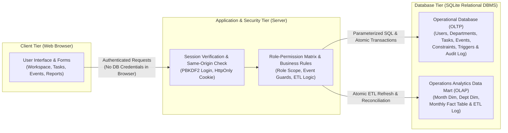

# CS 213 – Database Management System (SA 3)
# DSC Operations Management System (DSC OMS) — Project Documentation

**Course:** CS 213 – Database Management System  
**Assessment:** SA 3 – Database Application Project  
**Prepared for:** Prof. Ivy Kim D. Machica  
**Project Folder:** `dsc-oms-cs213/`  
**Date:** November 26, 2026

---

## 1. What DSC OMS Is, Problem Statement & Scope

### 1.1 What Our Program Does
**DSC Operations Management System (DSC OMS)** is a web-based database application built for a student organization (**Developer Student Community — DSC**) to coordinate day-to-day operations from one central relational database. Instead of maintaining disconnected spreadsheets, officers and members sign in to one shared workspace where every department, member account, project, task, cross-department request, event, announcement, and management report stays consistent and auditable.

### 1.2 Problem Statement & Current Manual Process
- **Intended Users:** Organization leaders (**Lead**, **Co-Lead**), department heads (**Executive**), general members (**Member**), and temporary event officers (**Event Director**, **Team Head**).
- **Previous Manual Process:** Tasks, member rosters, event staffing, and announcements were tracked across separate spreadsheet tabs without transaction safety, access restrictions, or automated audit history.
- **Problems Solved by DSC OMS:**
  1. **Uncontrolled Edits & Role Confusion:** Spreadsheets let any editor overwrite protected records. DSC OMS enforces strict role permissions on the server and in the database.
  2. **Incomplete Multi-Step Updates:** Actions that update multiple tables together (such as creating an Event task and linking its receipt and audit log, or closing an Event) previously risked partial saves. DSC OMS executes them as all-or-nothing database transactions.
  3. **Inconsistent Management Reports:** Leaders could not reliably filter active work, exclude `Draft` or `Archived` entries, catch overdue deadlines early, or reconcile monthly totals against a separate analytical reporting table.

### 1.3 System Scope
- **What the System WILL Do:**
  - Authenticate active users with **PBKDF2-SHA256** (`100,000` iterations) password hashing and secure `HttpOnly` session cookies.
  - Manage core directory and work records: **Departments** (Lead-only Create, Rename, and Soft Activate/Deactivate), **Users**, **Projects**, **Tasks**, **Cross-Department Requests**, and **Announcements**.
  - Coordinate **Events** through a structured 11-stage workflow (Proposal, Approval, Team Formation, Planning, Preparation, Readiness, Execution, Post-Event, Closure, and Archived/Cancelled) with consent-based temporary appointments (**Event Director** and **Team Head**).
  - Enforce relational constraints, unique keys, and database triggers so invalid status changes or duplicate conflicting appointments cannot commit.
  - Produce three management reports (**Detailed**, **Grouped Summary**, and **Exception Reports**) and load a reconciled star-schema **Operations Analytics Data Mart**.
- **What the System WILL NOT Do:**
  - The user's browser **never** connects directly to the SQLite database or stores database credentials; every database query runs strictly on the server tier.
  - Temporary event officers (**Event Director**, **Team Head**) **never** gain permanent administrative privileges (such as editing tasks globally, changing user roles, or viewing restricted executive reports).
  - It does **not** process financial payments or synchronize live with external Google Sheets (controlled CSV import/export handles bulk independent task entry).

---

## 2. Application of CS 213 DBMS Concepts & Class Instructions

| CS 213 Concept / Professor Instruction | How It Is Applied in DSC OMS |
| --- | --- |
| **Three-Level Database Design & 3NF** | Modeled separately at Conceptual, Logical (normalized through 3NF with explicit associative tables), and Physical SQLite levels using pure **Crow's Foot notation** in `02_THREE_LEVEL_ERDS_AND_NORMALIZATION.md`. |
| **Data Dictionary & Constraints** | Every table documents exact column meanings, data types, `PRIMARY KEY`, `FOREIGN KEY` (`ON DELETE RESTRICT` / `CASCADE`), `UNIQUE` case-insensitive constraints, `CHECK` domains, and reporting indexes in `03_DATA_DICTIONARY.md`. |
| **Security & Role–Permission Matrix** | Implements local login/logout with salted PBKDF2-SHA256 passwords, revocable database sessions, parameterized SQL queries (preventing SQL injection), and a server-verified Role–Permission Matrix (`Lead`, `Co-Lead`, `Executive`, `Member`, temporary event roles). |
| **Transactions, Rollback & Concurrency** | Multi-table workflows (such as delegated Event task creation and Event closure) execute inside single atomic database batches; database triggers abort invalid states (`0` orphan rows), and partial unique indexes block concurrent double-assignments. |
| **Operational Reporting Suite** | Provides a **Detailed Report** (date/department/status filters), a **Grouped Summary Report** (excluding `Archived` tasks and `Draft` projects/events), and an **Exception Report** (overdue work, unassigned priority tasks, and urgent unresolved issues). |
| **Data Warehousing / Data Mart & Reconciliation** | Implements an analytical star schema (`dm_dim_month`, `dm_dim_department`, `dm_fact_department_monthly_tasks`, `dm_etl_runs`) populated atomically from operational tables and verified to match live OLTP totals month-by-month. |
| **Immutable Audit Trail** | Automatically records security and data mutations (`AUTH_LOGIN_SUCCESS`, `AUTH_LOGIN_FAILED`, `USER_CREATED`, `DEPARTMENT_CREATED`, `EVENT_TASK_CREATED`, `DATAMART_ETL_LOADED`) inside `activity_log`. |

---

## 3. Functional & DBMS Requirements (`Core` vs. `Enhancement`)

| ID | Category | Classification | Requirement Statement |
| --- | --- | --- | --- |
| `FR-01` | Operations | **Core** | Authorized permanent roles (`Lead`, `Co-Lead`, `Executive`) shall create, view, search, filter, update, and archive or soft-deactivate tasks, projects, and department records. |
| `FR-02` | Integrity | **Core** | The database shall prevent duplicate department names, user emails, event team names, and converted request links using `UNIQUE` constraints. |
| `FR-03` | Governance | **Core** | The system shall enforce the 11-stage Event lifecycle and consent-based temporary officer appointments (`Proposed` → `Accepted`/`Declined`/`Ended`). |
| `FR-04` | Delegation | **Enhancement** | Accepted **Event Directors** and **Team Heads** may create unassigned Event tasks during `Team Formation` through `Post-Event` without expanding permanent system permissions. |
| `FR-05` | Data Entry | **Enhancement** | Authorized users may preview and import up to 100 unassigned independent tasks from CSV with duplicate checking and safe retry tracking. |
| `SEC-01` | Security | **Enhancement** | Users authenticate via email and password verified against PBKDF2-SHA256 hashes, backed by revocable server sessions that deny access immediately upon sign-out. |
| `SEC-02` | Security | **Core** | The server shall enforce the Role–Permission Matrix on every action, rejecting unauthorized direct requests (`403 Forbidden`) even if UI buttons are hidden. |
| `SEC-03` | Security | **Core** | All SQL statements shall use parameterized query bindings to prevent SQL injection, and cross-origin write requests are blocked on the server. |
| `SEC-04` | Auditing | **Core** | Sensitive security and data mutations shall be recorded in `activity_log` with actor identity, role, timestamp, and target record ID. |
| `SEC-05` | Security | **Enhancement** | Delegated Event task creation shall reject unauthorized privilege fields (such as forcing an assignee, project, department, or status) with a validation error. |
| `TRX-01` | Transactions | **Enhancement** | Creating an Event task shall atomically write the task, link record, idempotency receipt, and audit entries in one transaction; any failure rolls back all changes completely. |
| `TRX-02` | Concurrency | **Core** | Simultaneous conflicting requests (such as two users proposing two different `Event Director`s for the same Event) shall allow only one commit and reject the conflict (`409`). |
| `TRX-03` | Reliability | **Enhancement** | Retrying an Event task submission with the same request ID returns the existing task safely without duplicates, while altering fields rejects the conflict (`409`). |
| `RPT-01` | Reporting | **Enhancement** | Leaders shall generate a **Detailed Task Records Report** filterable by creation date range, department, and status, excluding `Archived` records by default. |
| `RPT-02` | Reporting | **Enhancement** | Leaders shall generate a **Grouped Summary Report** by department that excludes `Archived` tasks and `Draft` projects/events and displays exact excluded counts. |
| `RPT-03` | Reporting | **Enhancement** | Leaders shall generate an **Exception Report** for a chosen cutoff date flagging overdue incomplete tasks, unassigned `High`/`Critical` tasks, and urgent unresolved event issues. |
| `ADV-01` | Data Mart | **Enhancement** | An atomic ETL process shall summarize non-archived tasks into monthly department star-schema tables (`dm_dim_month`, `dm_dim_department`, `dm_fact_department_monthly_tasks`). |
| `ADV-02` | Data Mart | **Enhancement** | The Data Mart shall reconcile every month and the grand total against live operational tables and show a clear reconciled or out-of-sync status. |

---

## 4. Core Business Rules

1. **Account & Session Rules:** Only `Active` users with valid password credentials may hold an active session; deactivating a user or signing out revokes their active session tokens immediately.
2. **Department & Referential Protection:** Every user and task belongs to an accountable department. Departments with historical records cannot be hard-deleted (`ON DELETE RESTRICT`); the `Lead` uses soft activation/deactivation instead.
3. **Task Workflow Integrity:** Tasks progress strictly along valid lifecycle states (`Created` → `Assigned` → `Ongoing` → `For Review` → `Approved` → `Completed` ↔ `Archived`), and deadlines cannot precede start dates.
4. **Database Guards Against Invalid States:** Database triggers and partial unique indexes automatically block:
   - Demoting or deactivating the last active **Lead**;
   - Creating an Event task if the user was deactivated, their appointment ended, or the Event moved to `For Closure`/`Completed`/`Cancelled`;
   - Appointing two simultaneous active/proposed **Event Directors** for the same Event or two **Team Heads** for the same Team;
   - Advancing an Event to `Ready for Event` while `High`/`Urgent` operational issues remain unresolved or readiness items remain unverified.

---

## 5. Role–Permission Matrix & Sample Security Test

### 5.1 Role–Permission Matrix

| System Function | Lead | Co-Lead | Executive | Member | Event Director *(Event only)* | Team Head *(Team only)* |
| --- | :---: | :---: | :---: | :---: | :---: | :---: |
| Sign In & Sign Out | Allowed | Allowed | Allowed | Allowed | Allowed | Allowed |
| View Directory, Tasks & Events | Allowed | Allowed | Allowed | Allowed | Allowed | Allowed |
| Create / Edit General Tasks | Allowed | Allowed | Own Dept | Denied | Denied *(unless Exec+)* | Denied *(unless Exec+)* |
| Create Unassigned Event Task | Allowed | Allowed | If Appointed | If Appointed | Event & Teams | Appointed Team Only |
| Import Independent Tasks (CSV) | Allowed | Allowed | Own Dept | Denied | Denied | Denied |
| Approve / Reject / Close Events | Allowed | Allowed | Denied | Denied | Denied | Denied |
| Create / Edit User Accounts | Allowed | Allowed | Denied | Denied | Denied | Denied |
| Change User Role / Deactivate Account | Allowed | Denied | Denied | Denied | Denied | Denied |
| Manage Departments (Create / Rename / Soft Status) | Allowed | Denied | Denied | Denied | Denied | Denied |
| View Reports, Audit Log & Run Data Mart ETL | Allowed | Allowed | Denied | Denied | Denied | Denied |

### 5.2 How Server-Side Security Is Applied
1. Each member holds one permanent role (`Lead`, `Co-Lead`, `Executive`, or `Member`) plus any accepted temporary Event appointments.
2. When signed in, the interface hides unauthorized navigation links (`Reports`, `Audit Log`, `Add Member`) based on the signed-in profile.
3. **Database & Server Authority:** Every server request verifies the session cookie, role permissions, department scope, and database triggers **before** saving changes—so bypassing the UI with a direct HTTP request still fails with `403 Forbidden`.

### 5.3 Sample Security Test Case (`TC-SEC-01`)

| Field | Details |
| --- | --- |
| **Test ID** | `TC-SEC-01` (Verifies `SEC-02` & `SEC-04`) |
| **Objective** | Confirm that only `Lead`/`Co-Lead` can create user accounts and view management reports, even when a `Member` sends direct server requests. |
| **Precondition** | Active `Lead` and `Member` accounts exist; account `test_clerk@example.test` does not exist. |
| **Steps** | 1. Sign in as `Member` and attempt direct user creation (`test_clerk@example.test`) and report access. 2. Confirm `test_clerk@example.test` does not exist in `users`. 3. Sign in as `Lead` and repeat the user creation request. |
| **Expected Result** | `Member` is blocked with `403 Forbidden` on both attempts (`0` rows inserted); `Lead` succeeds (`201 Created`) and `USER_CREATED` is logged. |
| **Executed Result** | **PASS:** `Member` denied `403` (`0` rows in `users`); `Lead` succeeded (`1` row created and audited). |

---

## 6. Three-Tier Client–Server Architecture & Request Walkthrough

### 6.1 Three-Tier System Architecture

### 6.2 Request-to-Result Walkthrough (Creating an Event Task — `TRX-01`)
1. **User Action:** An accepted Event Director (`demo.member@example.test`) fills out the task form inside the Event Workspace and clicks **Create Task**.
2. **Session & Origin Verification:** The server checks that the request comes from the same origin and validates the `HttpOnly` session cookie against active rows in `auth_sessions`.
3. **Permission & Rule Validation:** The server confirms the user holds an accepted Event Director appointment, the Event is in an eligible stage (`Team Formation`..`Post-Event`), no forbidden override fields were injected, and checks whether the `requestId` was already processed.
4. **Atomic Multi-Table Transaction:** Inside one database transaction (`batch`), the database inserts the new row into `tasks`, logs `TASK_CREATED` in `activity_log`, saves the retry receipt in `event_task_creation_requests`, links the task in `event_task_links`, and logs `EVENT_TASK_CREATED`. Database trigger `oms_event_task_creation_guard` double-checks account status, department status, and event stage before commit.
5. **Result Returned:** If all checks succeed, all 5 inserts commit together and the new task appears immediately. If any constraint or trigger fails, SQLite rolls back the entire transaction so **zero partial records** remain.

---

## 7. Reporting & Operations Data Mart Overview

1. **Detailed Task Records Report:** Queries task details joined with departments, projects, linked events, and active assignees using parameterized filters (`startDate`, `endDate`, `departmentId`, `status`), excluding `Archived` tasks by default.
2. **Grouped Summary Report:** Totals tasks per department (retaining soft-deactivated departments that still own historical non-archived work so operational totals always reconcile) while explicitly displaying excluded counts for `Archived` tasks and `Draft` projects/events.
3. **Exception Report:** Evaluates actionable operational exceptions as of a selected calendar date (`deadline <= asOfDate` incomplete tasks, unassigned `High`/`Critical` tasks, and unresolved `High`/`Urgent` event issues).
4. **Operations Analytics Data Mart & Reconciliation:** Summarizes non-archived operational tasks into a star schema (`dm_dim_month` × `dm_dim_department` → `dm_fact_department_monthly_tasks`) inside an atomic ETL batch logged in `dm_etl_runs`. It automatically verifies month-by-month and grand-total agreement against operational tables and alerts users if department changes in OLTP require refreshing the Data Mart.
