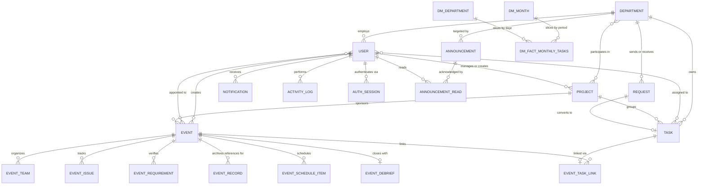
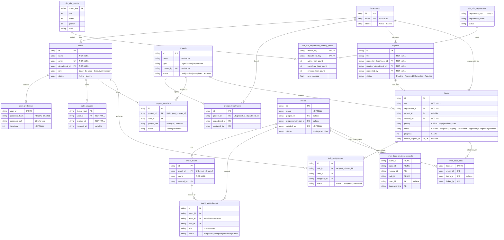
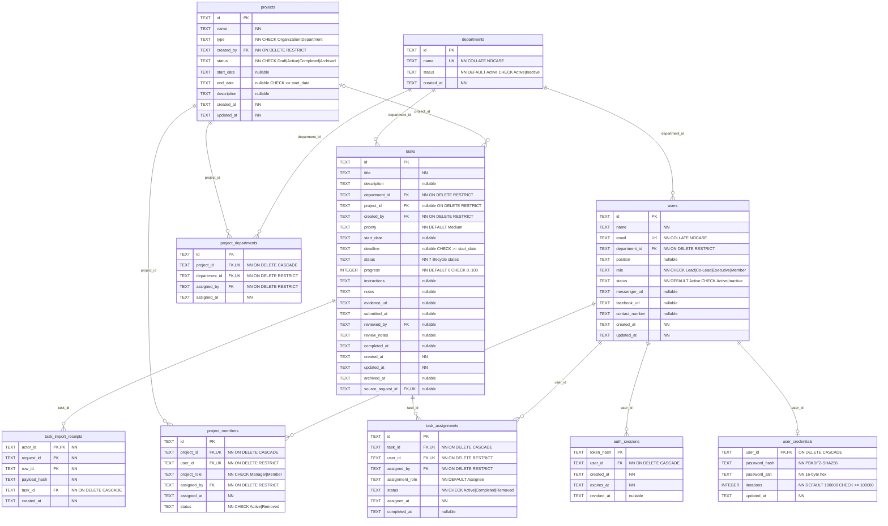
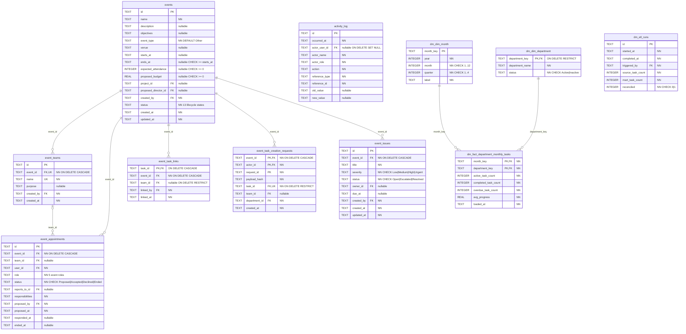

# CS 213 – Three Levels of Database Design (Three Separate Crow's Foot ERDs & 3NF)

This document presents the **three separate database design levels** for **DSC OMS (`dsc-oms-cs213`)** strictly in **Crow's Foot ERD notation** (Conceptual, Logical + 3NF, and Physical — no UML), using consistent entity and table names matching `migrations/0001_initial.sql` through `migrations/0010_cs213_auth_and_datamart.sql`.

---

## 1. Conceptual ERD (Crow's Foot Notation)

**Question Answered:** *What core business information does the organization need, and how do the main business entities relate?* (Database types, foreign-key columns, and indexes are intentionally omitted.)

---

## 2. Logical ERD & Normalization through 3NF

**Question Answered:** *How is the data structured into normalized relations with primary keys, foreign keys, and associative entities to eliminate redundancy?*

### 2.1 Logical ERD (Crow's Foot with Keys & Associative Entities)

### 2.2 Normalization Through Third Normal Form (3NF)
- **First Normal Form (1NF):** Every column stores atomic scalar values (no comma-separated lists or repeating groups). Multi-valued relationships are factored into associative tables: `project_departments`, `project_members`, `task_assignments`, `event_appointments`, `event_task_links`, and `announcement_reads`.
- **Second Normal Form (2NF):** Every table has either a single-column surrogate `id` primary key (so no partial dependencies on a composite key can exist) or a composite key (`event_task_creation_requests(event_id, actor_id, request_id)`, `task_import_receipts(actor_id, request_id, row_id)`, `announcement_reads(announcement_id, user_id)`, `dm_fact_department_monthly_tasks(month_key, department_key)`) where all non-key attributes depend on the **entire** composite key.
- **Third Normal Form (3NF):** Non-key attributes depend solely on their table's primary key (`users` stores `department_id` rather than duplicating `department_name`; `tasks` stores `department_id` and `project_id` rather than department/project names; `event_task_links` references `task_id` and `event_id` cleanly).
- **Documented Deliberate Exceptions to 3NF:**
  1. **`activity_log.actor_name` and `activity_log.actor_role`:** Intentionally snapshot the actor's display name and role at the moment an audit event occurs so historical audit records remain accurate even if the user is later renamed, changes role, or has `actor_user_id` set to `NULL`.
  2. **`dm_dim_department.department_name` & `dm_fact_department_monthly_tasks`:** Intentional OLAP star-schema denormalization for fast read-only analytical aggregation and historical period slicing, reconciled back to OLTP `tasks` via `dm_etl_runs`.

---

## 3. Physical ERD (Crow's Foot Notation — SQLite / Cloudflare D1 Schema)

**Question Answered:** *How is the database physically implemented in SQLite / Cloudflare D1, including exact column types, nullability, defaults, constraints, and indexes matching `migrations/0001`–`0010`?*

**Physical Crow's Foot Legend:**
- `PK` = Primary Key, `FK` = Foreign Key, `UK` = Unique Key/Constraint, `NN` = `NOT NULL`.
- All timestamps are ISO-8601 UTC strings stored as `TEXT`; SQLite `PRAGMA foreign_keys = ON` and database triggers (`oms_*`, `m3_*`) enforce state-transition and authorization invariants inside atomic D1 transactions.

### 3.1 Core Identity, Auth, Projects, Requests & Tasks Physical Tables (Crow's Foot)

**Physical Indexes (Core Identity, Auth, Projects & Tasks):**

| Table | Index / Unique Name | Indexed Columns & Condition | Purpose |
| --- | --- | --- | --- |
| `users` | `idx_users_department_status` | `(department_id, status)` | Fast active-member roster queries by department |
| `users` | `idx_users_role_status` | `(role, status)` | Last active `Lead` guard & executive lookup |
| `auth_sessions` | `idx_auth_sessions_user` | `(user_id, revoked_at)` | Fast session revocation on logout/deactivation |
| `projects` | `idx_projects_status_type` | `(status, type)` | Active project filtering & Draft exclusion |
| `projects` | `idx_projects_created_by` | `(created_by)` | Creator ownership queries |
| `project_departments` | `idx_project_departments_department` | `(department_id)` | Department-scoped project lookup |
| `project_members` | `ux_project_one_active_manager` | `UNIQUE(project_id) WHERE project_role='Manager' AND status='Active'` | Enforces at most 1 active manager per project |
| `tasks` | `idx_tasks_department_status_created` | `(department_id, status, created_at DESC)` | Grouped summary & detailed report filtering |
| `tasks` | `idx_tasks_status_deadline` | `(status, deadline)` | Exception report overdue deadline scans |
| `task_assignments` | `ux_task_one_active_assignment` | `UNIQUE(task_id) WHERE status='Active'` | Enforces at most 1 active assignee per task |

### 3.2 Events Governance, Operations, Audit & Data Mart Physical Tables (Crow's Foot)

**Physical Indexes (Events Governance, Audit & Data Mart):**

| Table | Index / Unique Name | Indexed Columns & Condition | Purpose |
| --- | --- | --- | --- |
| `events` | `idx_events_status_dates` | `(status, starts_at, ends_at)` | Stage & schedule timeline queries |
| `event_appointments` | `ux_event_one_open_director` | `UNIQUE(event_id) WHERE role='Event Director' AND status IN ('Proposed','Accepted')` | Concurrency lock: at most 1 open Director per Event |
| `event_appointments` | `ux_event_one_open_team_head` | `UNIQUE(event_id, team_id) WHERE role='Team Head' AND status IN ('Proposed','Accepted')` | Concurrency lock: at most 1 open Team Head per Team |
| `event_task_links` | `idx_event_tasks_event` | `(event_id, team_id)` | Event Workspace task filtering |
| `event_issues` | `idx_event_issues_active_report` | `(status, severity, event_id)` | Readiness gate & Exception Report scanning |
| `activity_log` | `idx_activity_created` | `(occurred_at DESC)` | Recent system audit feed |
| `activity_log` | `idx_activity_reference_created` | `(reference_type, reference_id, occurred_at DESC)` | Per-entity audit history lookup |
| `dm_fact_department_monthly_tasks` | `idx_dm_fact_dept` | `(department_key, month_key)` | Department trend & OLAP slicing |

*(Note: Supporting operational, governance, and communication tables `requests`, `notifications`, `event_approvals`, `event_stage_history`, `event_closure_records`, `event_requirements`, `event_requirement_history`, `event_records`, `event_schedule_items`, `event_debriefs`, `event_coordination_notes`, `announcements`, `announcement_reads`, and `announcement_history` are fully documented in [03_DATA_DICTIONARY.md](03_DATA_DICTIONARY.md).)*
